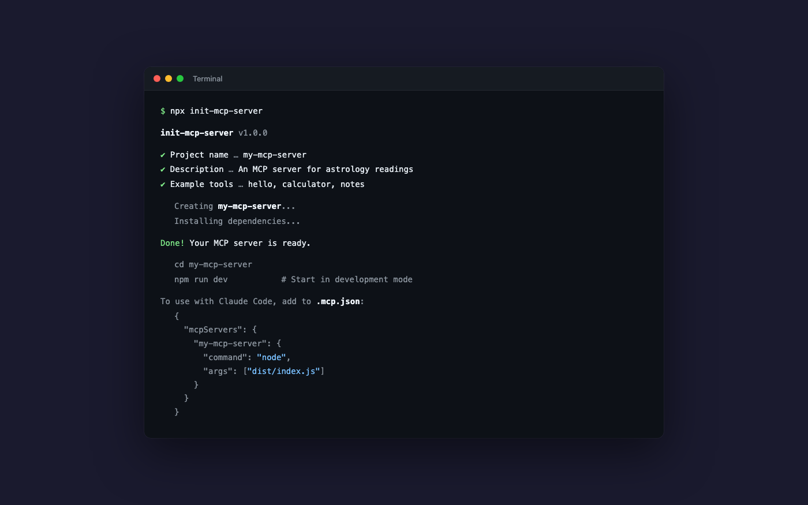

# init-mcp-server



Scaffold a TypeScript [Model Context Protocol](https://modelcontextprotocol.io/) server with optional example tools.

```bash
npx init-mcp-server
```

## What you get

- TypeScript project with the MCP SDK wired up
- Stdio transport ready to go
- Optional example tools (hello, calculator, notes, summarise)
- Dev mode with auto-reload via `tsx --watch`
- Ready-to-use config snippets for Claude Code and Claude Desktop

## Usage

Run the CLI and follow the prompts:

```bash
npx init-mcp-server
```

Or pass a project name directly:

```bash
npx init-mcp-server my-server
```

You'll be asked to pick which example tools to include:

| Tool | What it demonstrates |
|------|---------------------|
| **hello** | Minimal tool with no parameters |
| **calculator** | Zod input validation (add, multiply) |
| **notes** | Stateful tool (create and list notes) |
| **summarise** | Text processing with optional parameters |

Project names use 1 to 214 lowercase letters, numbers or hyphens and start with a letter or number. The same check applies to positional names and prompts. The generator creates a new child directory and leaves an existing directory or symlink untouched.

If dependency installation fails, generated files stay in place and the CLI explains how to continue with your package manager. Notes are held in memory while the example server runs; summarise selects sentences and does not call a model.

## After scaffolding

```bash
cd my-server
npm run dev          # Start with auto-reload
npm run build        # Compile TypeScript
npm start            # Run compiled server
```

## Adding your own tools

Create a file in `src/tools/` and register it in `src/index.ts`:

```typescript
import { z } from "zod";
import type { McpServer } from "@modelcontextprotocol/sdk/server/mcp.js";

export function registerMyTool(server: McpServer) {
  server.tool(
    "my-tool",
    "What it does",
    { input: z.string().describe("The input") },
    async ({ input }) => ({
      content: [{ type: "text", text: `Result: ${input}` }],
    })
  );
}
```

## Licence

MIT
